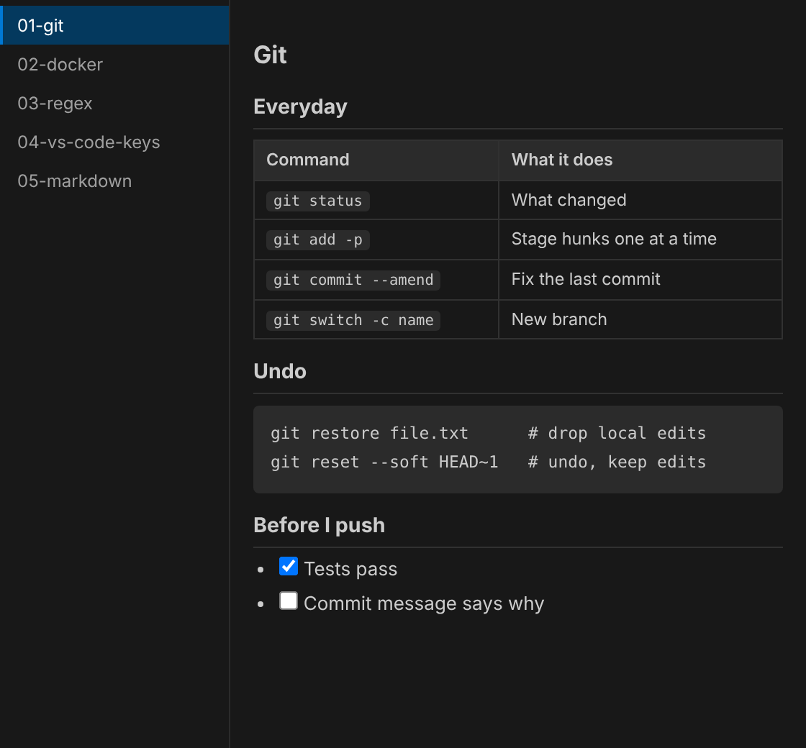

# Cheatsheets

Keep your own reference notes open while you code. Cheatsheets shows the Markdown and HTML files from a folder you choose in VS Code's secondary sidebar: the list on the left, the sheet on the right. One shortcut shows it and hides it.



## Features

- **Markdown and HTML.** Write quick sheets in Markdown (tables, code blocks, and task lists all render), or build fully styled reference pages in HTML.
- **Your own folder.** Every `.md` and `.html` file in the folder appears in the list, sorted by name.
- **Stays current.** Add, rename, or edit a file and the panel updates on its own.
- **Checklists that remember.** Tick a `- [ ]` box and it stays ticked the next time you open the sheet.
- **Fully local.** Nothing is sent anywhere, and no internet connection is needed.

## Get started

1. Install **Cheatsheets** from the Extensions view (search "Cheatsheets" by owencorpening).
2. Open Settings (`Ctrl+,`, Mac `Cmd+,`), search for **cheatsheets**, and set **Cheatsheets: Folder** to your cheatsheets folder, for example `C:\Users\you\cheatsheets` or `/home/you/cheatsheets`.
3. Press **Ctrl+Alt+C** (Mac: **Ctrl+Cmd+C**) to open the panel.

If you leave the folder setting empty, Cheatsheets uses the folder you have open in VS Code.

## Usage

| What | How |
|------|-----|
| Show the panel, or hide the sidebar | `Ctrl+Alt+C` (Mac: `Ctrl+Cmd+C`), or **Cheatsheets: Toggle Panel** |
| Open a cheatsheet | Click it in the list |
| Reload the list by hand | **Cheatsheets: Refresh** from the Command Palette |
| Change the shortcut | Keyboard Shortcuts (`Ctrl+K Ctrl+S`), search "Cheatsheets" |

## Tips

- Prefix file names with numbers to set the order: `01-git.md`, `02-docker.md`.
- HTML sheets run as self-contained pages, with their own styles and scripts. Use them for multi-column layouts, color-coded sections, or collapsible blocks.
- Only open HTML sheets you wrote or trust, since their scripts run inside the panel.
- Drag the panel to another spot in the sidebar and VS Code remembers where you put it.

## Privacy

Cheatsheets reads files only from the folder you choose. It collects nothing, sends nothing, and has no analytics. Checkbox state is kept by VS Code on your own machine.

## Support

Report a problem or ask for a feature on [GitHub Issues](https://github.com/owencorpening/cheatsheets-vscode/issues). More at [owensappliedthinking.com/tools/cheatsheets](https://owensappliedthinking.com/tools/cheatsheets/).

## Build from source

```bash
npm test                 # runs the tests with plain Node, no install needed
npx @vscode/vsce package # builds cheatsheets-<version>.vsix
code --install-extension cheatsheets-0.2.0.vsix
```

---

Free and open source (MIT) from [Owen's Applied Thinking](https://owensappliedthinking.com/).
